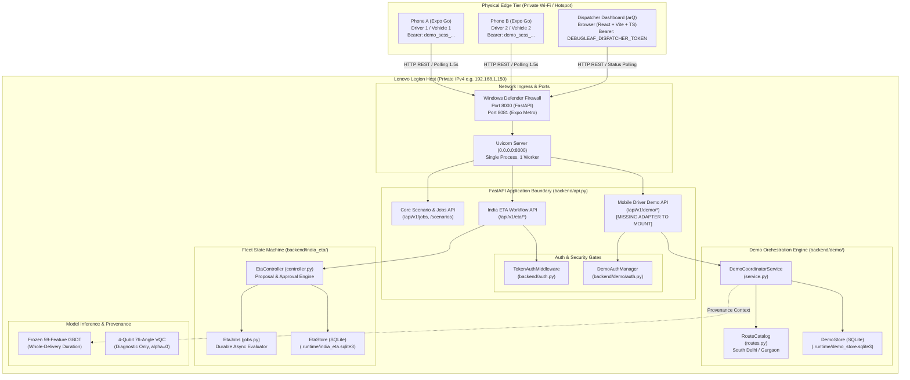
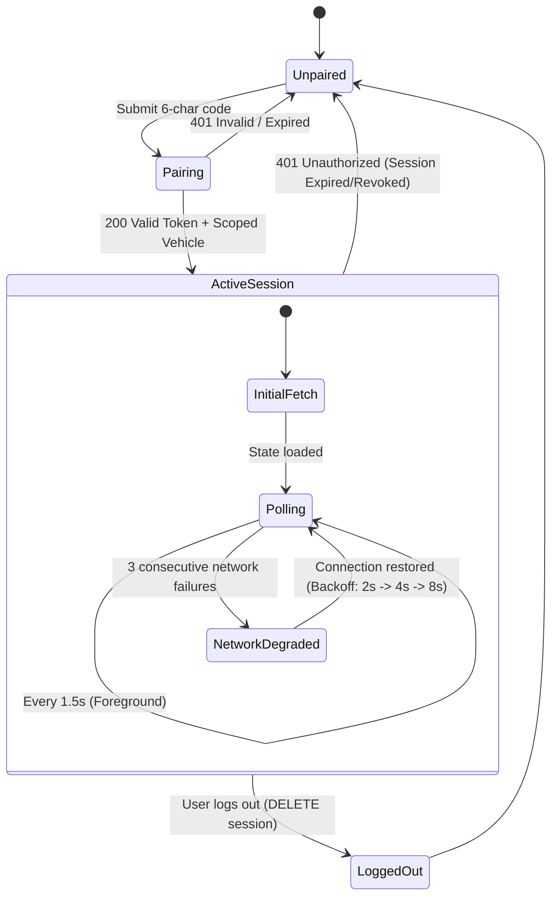
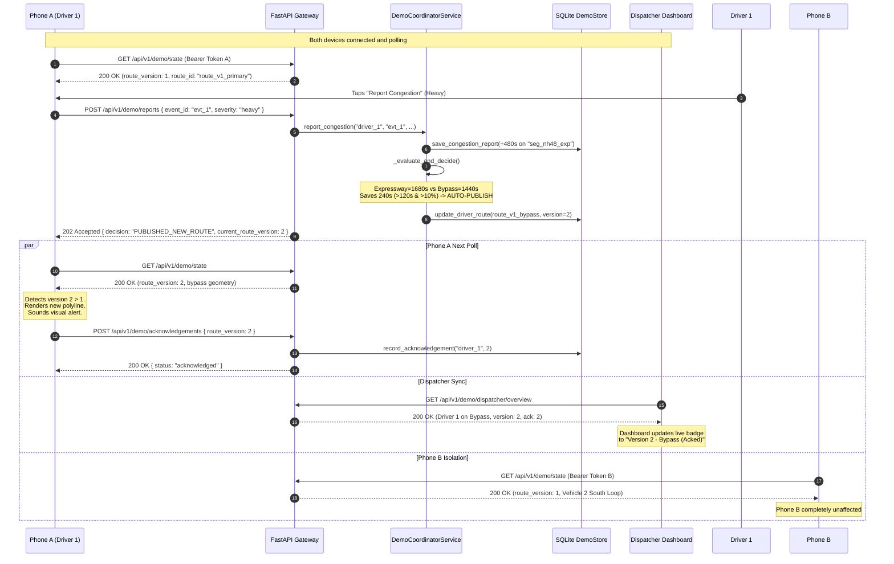

# DEBUGLEAF / arQ — COMPLETE MOBILE AND DISPATCHER INTEGRATION ARCHITECTURE

**System Identity:** DebugLeaf (`debugleaf`) / arQ (`arQ`)  
**Track:** Quant-A-Maze 3.0 — QML Track (Problem `QML-01`: Delay-Risk-Aware Fleet Dispatch for Contract Logistics)  
**Primary Integration Goal:** Establish reliable, server-authoritative, cross-device synchronization between two physical driver phones (running Expo Go), the dispatcher web dashboard, and the local FastAPI backend on the Lenovo Legion host.

---

## 1. System Architecture & End-to-End Module Topology

The system operates as a single-process FastAPI application backed by WAL-mode SQLite databases. Physical phones connect over a private LAN/hotspot directly to the host's private IP.



### Data Flow for Demo Sequence
1. **Pairing**: Phone A posts code `PAIR01` to `POST /api/v1/demo/sessions`. `DemoAuthManager` redeems it atomically, records the session in `demo_store.sqlite3`, and returns a scoped session token `demo_sess_<hex>`.
2. **Authoritative Sync**: Phone A queries `GET /api/v1/demo/state`. Backend resolves identity to `driver_1` / `vehicle_1`, returning Route Version 1 (Expressway Route) with South Delhi GeoJSON coordinates. Phone B pairs with `PAIR02` and receives Route Version 1 for `vehicle_2` (South Arterial Loop).
3. **Congestion Trigger**: Driver 1 taps *Report Congestion* (Heavy). Phone A posts to `POST /api/v1/demo/reports` with a unique `event_id`.
4. **Server Re-evaluation**: `DemoCoordinatorService` admits the report, applies a synthetic +480s delay to segment `seg_nh48_exp`, and re-scores alternative candidates. The Mehrauli Bypass (`seg_mgroad_bypass`) saves 240 seconds (> 120s threshold and > 10% relative gain).
5. **Auto-Publication & Monotonic Bump**: Backend updates `driver_state`, incrementing `route_version` from 1 to 2 and `manifest_revision` from 1 to 2.
6. **Client Re-sync & Ack**: On Phone A's next 1.5s poll, it observes `route_version: 2`, detects a server route revision, displays the updated route polyline with simulated provenance tag, and automatically posts to `POST /api/v1/demo/acknowledgements`. Phone B's state remains untouched.

---

## 2. Confirmed Existing Backend Endpoints

Inspected directly from source code in `backend/api.py`, `backend/india_eta/api.py`, and `backend/demo/`:

### Core Optimization & Recovery API (`backend/api.py`)
| Method | Path | Status | Request Envelope | Response Envelope | Auth / Guard |
| :--- | :--- | :--- | :--- | :--- | :--- |
| `GET` | `/api/v1/health` | 200 | *None* | `{"status": "ok"}` | Open |
| `POST` | `/api/v1/scenarios/validate` | 200 | Scenario object | `{"valid": bool, "errors": [...]}` | Open / Token probe |
| `POST` | `/api/v1/scenarios/routes` | 200 | Scenario object | `{"routes": [...]}` | Valid scenario |
| `POST` | `/api/v1/scenarios/plan` | 200 | Scenario object | Plan object | Max 2 compute slots |
| `POST` | `/api/v1/scenarios/financial-plan` | 200 | Scenario + monetary terms | Financial Plan object | Validated cover |
| `POST` | `/api/v1/scenarios/qaoa` | 200 | Scenario + QAOA settings | QAOA Plan + bitstrings | Local CPU simulator |
| `POST` | `/api/v1/recovery/plan` | 200 | Disruptions + locked prefixes | Repaired Plan object | Prefix-locked |
| `GET` | `/api/v1/recovery/audits/latest`| 200 | *Query: `scope_sha256`* | Latest recovery audit | Filtered scope |
| `POST` | `/api/v1/jobs` | 202 | Scenario object | `{"job_id": str, "status": "pending"}` | ThreadPool queue |
| `GET` | `/api/v1/jobs/{job_id}` | 200 | *Path: `job_id`* | `JobRecord` | 404 if missing |
| `POST` | `/api/v1/jobs/{job_id}/cancel` | 200 | *Path: `job_id`* | `JobRecord` (cancelled) | Atomic cancel |

### India ETA Dispatcher API (`backend/india_eta/api.py`)
Mounted under router prefix `/api/v1/eta`:

| Method | Path | Status | Request Envelope | Response Envelope | Auth / Guard |
| :--- | :--- | :--- | :--- | :--- | :--- |
| `POST` | `/api/v1/eta/predictions` | 200 | Allowlisted delivery features | Model prediction (seconds) | Frozen GBDT / VQC |
| `POST` | `/api/v1/eta/sla` | 200 | Feature context + SLA limit | Breach probability & CVaR | Uncertainty model |
| `POST` | `/api/v1/eta/compatibility` | 200 | Model & scenario metadata | Feature compatibility matrix | Schema check |
| `POST` | `/api/v1/eta/plans` | 200 | Full fleet plan registration | Active registered plan | **Dispatcher/Admin Token** |
| `GET` | `/api/v1/eta/plans/{plan_id}` | 200 | *Path: `plan_id`* | Active plan record | Open |
| `POST` | `/api/v1/eta/events` | 202 | Disruption event envelope | `{"job_id": str, "status": "pending"}` | Bounded validation |
| `GET` | `/api/v1/eta/events/{event_id}`| 200 | *Path: `event_id`* | Event processing status | Open |
| `GET` | `/api/v1/eta/proposals/{proposal_id}` | 200 | *Path: `proposal_id`* | Replan candidate proposal | Open |
| `POST` | `/api/v1/eta/proposals/{proposal_id}/approve` | 200 | `{"base_version", "event_id", "context_hash"}` | Published plan + manifest | **Dispatcher/Admin Token** |
| `GET` | `/api/v1/eta/manifests/{vehicle_id}` | 200 | *Query: `version`* | Authoritative manifest | Stored manifest |

### Demo Python Service Status (`backend/demo/`)
- `backend/demo/auth.py`, `service.py`, `routes.py`, `store.py` are implemented and pass unit tests (`test_demo_service.py`).
- **CRITICAL AUDIT FINDING:** There is currently **NO HTTP ROUTER** (`backend/demo/api.py`) mounted in `backend/api.py`. The endpoints `/api/v1/demo/*` do not exist over the wire yet.

---

## 3. Missing Backend Endpoints (Handoff Specification)

The backend team must create `backend/demo/api.py` and mount it into `backend/api.py`.

```
MISSING FILE TO CREATE:  backend/demo/api.py
FILE TO MODIFY:          backend/api.py (lines 584: app.include_router(create_demo_router(...)))
```

### Detailed Endpoint Specification to Implement

#### 1. `POST /api/v1/demo/sessions`
- **Purpose**: Redeem one-time pairing code for an opaque session token.
- **Request Body**:
  ```json
  { "code": "PAIR01" }
  ```
- **Response (200 OK)**:
  ```json
  {
    "token": "demo_sess_a8f9c104e768b24d7731f90e5561a0b3884c7d01",
    "expires_at": "2026-10-30T05:21:54.000000Z",
    "driver_id": "driver_1",
    "vehicle_id": "vehicle_1",
    "driver_name": "Ramesh Kumar"
  }
  ```
- **Error (401 Unauthorized)**:
  ```json
  { "error": { "code": "invalid_code", "message": "Pairing code is invalid or already used" } }
  ```

#### 2. `DELETE /api/v1/demo/sessions/current`
- **Purpose**: Revoke driver session on logout.
- **Headers**: `Authorization: Bearer demo_sess_...`
- **Response (200 OK)**: `{"status": "revoked"}`

#### 3. `GET /api/v1/demo/me`
- **Purpose**: Return server-verified identity of the authenticated phone.
- **Headers**: `Authorization: Bearer demo_sess_...`
- **Response (200 OK)**:
  ```json
  {
    "driver_id": "driver_1",
    "vehicle_id": "vehicle_1",
    "driver_name": "Ramesh Kumar",
    "role": "driver",
    "simulation_mode": true
  }
  ```

#### 4. `GET /api/v1/demo/state`
- **Purpose**: Authoritative driver route state, GeoJSON polyline, stops, and version.
- **Headers**: `Authorization: Bearer demo_sess_...`
- **Response (200 OK)**:
  ```json
  {
    "schema_version": "1.0.0",
    "driver_id": "driver_1",
    "vehicle_id": "vehicle_1",
    "route_id": "route_v1_primary",
    "corridor_id": "corridor_a_expressway",
    "route_version": 1,
    "manifest_revision": 1,
    "status": "en_route",
    "estimated_duration_seconds": 1200.0,
    "estimated_distance_metres": 12700.0,
    "active_overlays": {},
    "simulation_mode": true,
    "data_provenance": "synthetic_delhivery_v1",
    "geojson": {
      "type": "Feature",
      "geometry": {
        "type": "LineString",
        "coordinates": [
          [77.1025, 28.5245],
          [77.088, 28.512],
          [77.065, 28.498],
          [77.042, 28.486],
          [77.031, 28.479]
        ]
      },
      "properties": {
        "route_id": "route_v1_primary",
        "corridor_id": "corridor_a_expressway",
        "name": "Expressway Route (Fastest Base)",
        "stop_ids": ["depot", "stop_1", "stop_2", "depot"]
      }
    },
    "stops": [
      { "id": "depot", "name": "Okhla Hub Depot", "coordinates": [77.1025, 28.5245], "status": "completed" },
      { "id": "stop_1", "name": "Cyber Hub, Gurgaon", "coordinates": [77.031, 28.479], "status": "next" },
      { "id": "stop_2", "name": "Udyog Vihar Phase IV", "coordinates": [77.025, 28.485], "status": "pending" },
      { "id": "depot", "name": "Okhla Hub Depot", "coordinates": [77.1025, 28.5245], "status": "pending" }
    ],
    "last_ack_version": 1,
    "updated_at": "2026-10-30T01:21:54.000000Z"
  }
  ```

#### 5. `POST /api/v1/demo/reports`
- **Purpose**: Driver submits an incident/congestion event. Evaluates re-route immediately.
- **Headers**: `Authorization: Bearer demo_sess_...`
- **Request Body**:
  ```json
  {
    "event_id": "client-uuid-9821-43ef",
    "base_route_version": 1,
    "kind": "congestion",
    "severity": "heavy",
    "note": "Traffic gridlock at Mahipalpur flyover"
  }
  ```
- **Response (202 Accepted)**:
  ```json
  {
    "status": "accepted",
    "event_id": "client-uuid-9821-43ef",
    "job_id": "job_cong_87b12d593e41",
    "delay_applied_seconds": 480.0,
    "segment_id": "seg_nh48_exp",
    "decision": "PUBLISHED_NEW_ROUTE",
    "published_new_route": true,
    "current_route_version": 2
  }
  ```

#### 6. `POST /api/v1/demo/route-requests`
- **Purpose**: Driver manually triggers a plan-route re-evaluation.
- **Headers**: `Authorization: Bearer demo_sess_...`
- **Request Body**:
  ```json
  {
    "request_id": "client-req-5541-11aa",
    "base_route_version": 1
  }
  ```
- **Response (202 Accepted)**:
  ```json
  {
    "job_id": "job_plan_1029384756ab",
    "status": "completed",
    "outcome": "KEEP",
    "result": { "decision": "KEEP", "reason": "Current route optimal" }
  }
  ```

#### 7. `GET /api/v1/demo/jobs/{job_id}`
- **Purpose**: Inspect state of a durable demo planning job.
- **Headers**: `Authorization: Bearer demo_sess_...`
- **Response (200 OK)**:
  ```json
  {
    "job_id": "job_cong_87b12d593e41",
    "status": "completed",
    "outcome": "PUBLISHED_NEW_ROUTE",
    "result": {
      "published": true,
      "previous_route": "Expressway Route (Fastest Base)",
      "previous_cost_seconds": 1680.0,
      "new_route": "Mehrauli Bypass (Congestion Alternate)",
      "new_cost_seconds": 1440.0,
      "time_saved_seconds": 240.0,
      "route_version": 2
    }
  }
  ```

#### 8. `POST /api/v1/demo/acknowledgements`
- **Purpose**: Confirm device rendered the new route version.
- **Headers**: `Authorization: Bearer demo_sess_...`
- **Request Body**:
  ```json
  { "route_version": 2, "client_timestamp": "2026-10-30T01:22:15.120Z" }
  ```
- **Response (200 OK)**:
  ```json
  { "status": "acknowledged", "driver_id": "driver_1", "version": 2 }
  ```

#### 9. `GET /api/v1/demo/dispatcher/overview`
- **Purpose**: Real-time aggregated fleet status for the arQ dashboard.
- **Headers**: `Authorization: Bearer <DEBUGLEAF_DISPATCHER_TOKEN>`
- **Response (200 OK)**:
  ```json
  {
    "drivers": [
      {
        "driver_id": "driver_1",
        "driver_name": "Ramesh Kumar",
        "vehicle_id": "vehicle_1",
        "status": "en_route",
        "route_version": 2,
        "corridor": "corridor_b_bypass",
        "last_ack_version": 2,
        "active_delay_seconds": 480.0
      },
      {
        "driver_id": "driver_2",
        "driver_name": "Suresh Sharma",
        "vehicle_id": "vehicle_2",
        "status": "en_route",
        "route_version": 1,
        "corridor": "corridor_c_south",
        "last_ack_version": 1,
        "active_delay_seconds": 0.0
      }
    ],
    "active_incidents": [
      {
        "event_id": "client-uuid-9821-43ef",
        "driver_id": "driver_1",
        "segment_id": "seg_nh48_exp",
        "severity": "heavy",
        "delay_seconds": 480.0,
        "reported_at": "2026-10-30T01:22:00.000000Z"
      }
    ]
  }
  ```

---

## 4. Mobile File Tree

Structure for `mobile/` built with Expo SDK 51, React Native 0.74, and TypeScript:

```text
mobile/
├── .env.example                       # API Base URL template
├── .gitignore
├── app.json                           # Expo app configuration
├── package.json                       # Verified Expo Go compatible packages
├── tsconfig.json                      # Strict TypeScript settings
├── App.tsx                            # Root entrypoint & providers
│
├── src/
│   ├── api/
│   │   ├── client.ts                  # Fetch client with token injection & error sanitization
│   │   ├── session.ts                 # Pairing & revocation calls
│   │   ├── driver.ts                  # State, acknowledgements, route-requests
│   │   ├── reports.ts                 # Congestion & incident reporting
│   │   └── types.ts                   # Authoritative TypeScript types matching backend schemas
│   │
│   ├── auth/
│   │   ├── SessionContext.tsx         # React context for driver credentials & vehicle binding
│   │   └── tokenStorage.ts            # expo-secure-store wrapper with memory fallback
│   │
│   ├── config/
│   │   ├── env.ts                     # Environment configuration (IP, port, timeouts)
│   │   └── constants.ts               # Polling intervals (1500ms), retry backoff rules
│   │
│   ├── features/
│   │   ├── sync/
│   │   │   ├── useDriverSync.ts       # Foreground polling hook & revision reconciler
│   │   │   └── syncReducer.ts         # Reducer handling route transitions & ack states
│   │   │
│   │   ├── map/
│   │   │   ├── CoordinateTransform.ts # GeoJSON [lon, lat] -> Map {lat, lon} converter
│   │   │   ├── RouteMap.tsx           # Polyline & stop marker renderer
│   │   │   └── RouteListFallback.tsx  # List-first fallback UI when tiles fail
│   │   │
│   │   └── driver/
│   │       ├── StopTimeline.tsx       # Ordered stop cards with delivery status
│   │       ├── RouteSummaryCard.tsx   # Duration, distance, and provenance badge
│   │       └── CongestionModal.tsx    # One-tap incident reporting modal
│   │
│   ├── components/
│   │   ├── NetworkBanner.tsx          # Realtime server connectivity & latency indicator
│   │   ├── ProvenanceBadge.tsx        # "Simulated Geometry | Frozen GBDT" label
│   │   ├── StatusPill.tsx             # Color-coded operational status pill
│   │   ├── PrimaryButton.tsx          # Large driver-friendly touch target button
│   │   └── ConnectionDiagnostics.tsx  # IP ping and latency test widget
│   │
│   └── screens/
│       ├── PairingScreen.tsx          # 6-character one-time pairing code entry
│       ├── DriverHomeScreen.tsx       # Main operational cockpit: map, stops, actions
│       ├── RouteDetailsScreen.tsx     # Full stop list and segment breakdown
│       ├── ReportCongestionScreen.tsx # Severity selection (Moderate/Heavy)
│       └── RouteUpdatedAlert.tsx      # Modal banner when route_version increments
```

---

## 5. Authoritative Typed TypeScript Contracts

File: `mobile/src/api/types.ts`

```typescript
/**
 * Strict API contract definitions matching DebugLeaf / arQ backend schemas.
 */

export type SeverityLevel = 'moderate' | 'heavy';
export type DriverStatus = 'assigned' | 'en_route' | 'delayed' | 'completed';
export type JobStatus = 'pending' | 'running' | 'completed' | 'failed' | 'cancelled';
export type DecisionOutcome = 'KEEP' | 'PUBLISHED_NEW_ROUTE' | 'PROPOSE_REPLAN' | 'ALERT';

export interface ApiErrorEnvelope {
  error: {
    code: string;
    message: string;
    details?: Array<{ field: string; message: string }>;
  };
  request_id?: string;
}

// 1. Session & Pairing
export interface PairingRequest {
  code: string;
}

export interface PairingResponse {
  token: string;
  expires_at: string;
  driver_id: string;
  vehicle_id: string;
  driver_name: string;
}

export interface DriverIdentity {
  driver_id: string;
  vehicle_id: string;
  driver_name: string;
  role: 'driver';
  simulation_mode: boolean;
}

// 2. Map & GeoJSON
export type GeoJsonPosition = [number, number]; // [longitude, latitude]

export interface GeoJsonGeometry {
  type: 'LineString';
  coordinates: GeoJsonPosition[];
}

export interface GeoJsonFeature {
  type: 'Feature';
  geometry: GeoJsonGeometry;
  properties: {
    route_id: string;
    corridor_id: string;
    name: string;
    stop_ids: string[];
    duration_seconds?: number;
    distance_metres?: number;
  };
}

export interface DeliveryStop {
  id: string;
  name: string;
  coordinates: GeoJsonPosition; // [lon, lat]
  status: 'pending' | 'next' | 'completed';
  window?: [string, string];
}

// 3. Authoritative Driver State
export interface DriverStateResponse {
  schema_version: '1.0.0';
  driver_id: string;
  vehicle_id: string;
  route_id: string;
  corridor_id: string;
  route_version: number;
  manifest_revision: number;
  status: DriverStatus;
  estimated_duration_seconds: number;
  estimated_distance_metres: number;
  active_overlays: Record<string, number>; // segment_id -> delay_seconds
  simulation_mode: boolean;
  data_provenance: 'synthetic_delhivery_v1' | 'frozen_gbdt_run2' | 'simulated_incident';
  geojson: GeoJsonFeature | null;
  stops: DeliveryStop[];
  last_ack_version: number;
  last_ack_at?: string;
  updated_at: string;
}

// 4. Congestion & Incidents
export interface CongestionReportRequest {
  event_id: string;
  base_route_version: number;
  kind: 'congestion';
  severity: SeverityLevel;
  note?: string;
}

export interface CongestionReportResponse {
  status: 'accepted';
  event_id: string;
  job_id: string;
  delay_applied_seconds: number;
  segment_id: string;
  decision: DecisionOutcome;
  published_new_route: boolean;
  current_route_version: number;
}

// 5. Route Plan Request
export interface PlanRouteRequest {
  request_id: string;
  base_route_version: number;
}

export interface PlanRouteResponse {
  job_id: string;
  status: JobStatus;
  outcome: DecisionOutcome;
  result: {
    decision: DecisionOutcome;
    reason?: string;
    published?: boolean;
    previous_route?: string;
    new_route?: string;
    time_saved_seconds?: number;
    route_version?: number;
  };
}

// 6. Acknowledgement
export interface RouteAcknowledgementRequest {
  route_version: number;
  client_timestamp: string;
}

export interface RouteAcknowledgementResponse {
  status: 'acknowledged';
  driver_id: string;
  version: number;
}
```

---

## 6. Example JSON Payloads (Wire Verification)

### A. Pairing Request & Response
`POST /api/v1/demo/sessions`
```json
// Request
{
  "code": "PAIR01"
}

// Response (200 OK)
{
  "token": "demo_sess_4f810bce90214c779e51bcf6a27e028b1234abcd",
  "expires_at": "2026-10-30T05:21:54.000000Z",
  "driver_id": "driver_1",
  "vehicle_id": "vehicle_1",
  "driver_name": "Ramesh Kumar"
}
```

### B. Driver State Query
`GET /api/v1/demo/state` (Headers: `Authorization: Bearer demo_sess_...`)
```json
{
  "schema_version": "1.0.0",
  "driver_id": "driver_1",
  "vehicle_id": "vehicle_1",
  "route_id": "route_v1_primary",
  "corridor_id": "corridor_a_expressway",
  "route_version": 1,
  "manifest_revision": 1,
  "status": "en_route",
  "estimated_duration_seconds": 1200.0,
  "estimated_distance_metres": 12700.0,
  "active_overlays": {},
  "simulation_mode": true,
  "data_provenance": "synthetic_delhivery_v1",
  "geojson": {
    "type": "Feature",
    "geometry": {
      "type": "LineString",
      "coordinates": [
        [77.1025, 28.5245],
        [77.0880, 28.5120],
        [77.0650, 28.4980],
        [77.0420, 28.4860],
        [77.0310, 28.4790],
        [77.0250, 28.4850],
        [77.0380, 28.5020],
        [77.1025, 28.5245]
      ]
    },
    "properties": {
      "route_id": "route_v1_primary",
      "corridor_id": "corridor_a_expressway",
      "name": "Expressway Route (Fastest Base)",
      "stop_ids": ["depot", "stop_1", "stop_2", "depot"]
    }
  },
  "stops": [
    { "id": "depot", "name": "Okhla Hub Depot", "coordinates": [77.1025, 28.5245], "status": "completed" },
    { "id": "stop_1", "name": "Cyber Hub, Gurgaon", "coordinates": [77.0310, 28.4790], "status": "next" },
    { "id": "stop_2", "name": "Udyog Vihar Phase IV", "coordinates": [77.0250, 28.4850], "status": "pending" },
    { "id": "depot", "name": "Okhla Hub Depot", "coordinates": [77.1025, 28.5245], "status": "pending" }
  ],
  "last_ack_version": 1,
  "updated_at": "2026-10-30T01:21:54.000000Z"
}
```

### C. Report Heavy Congestion
`POST /api/v1/demo/reports`
```json
// Request
{
  "event_id": "9b1deb4d-3b7d-4bad-9bdd-2b0d7b3dcb6d",
  "base_route_version": 1,
  "kind": "congestion",
  "severity": "heavy",
  "note": "Severe accident on NH-48 toll plaza"
}

// Response (202 Accepted)
{
  "status": "accepted",
  "event_id": "9b1deb4d-3b7d-4bad-9bdd-2b0d7b3dcb6d",
  "job_id": "job_cong_49f872110c",
  "delay_applied_seconds": 480.0,
  "segment_id": "seg_nh48_exp",
  "decision": "PUBLISHED_NEW_ROUTE",
  "published_new_route": true,
  "current_route_version": 2
}
```

### D. Driver State After Auto-Publication
`GET /api/v1/demo/state` (Polled automatically by Phone A)
```json
{
  "schema_version": "1.0.0",
  "driver_id": "driver_1",
  "vehicle_id": "vehicle_1",
  "route_id": "route_v1_bypass",
  "corridor_id": "corridor_b_bypass",
  "route_version": 2,
  "manifest_revision": 2,
  "status": "en_route",
  "estimated_duration_seconds": 1440.0,
  "estimated_distance_metres": 15400.0,
  "active_overlays": {
    "seg_nh48_exp": 480.0
  },
  "simulation_mode": true,
  "data_provenance": "synthetic_delhivery_v1",
  "geojson": {
    "type": "Feature",
    "geometry": {
      "type": "LineString",
      "coordinates": [
        [77.1025, 28.5245],
        [77.1200, 28.5050],
        [77.1110, 28.4820],
        [77.0950, 28.4680],
        [77.0310, 28.4790],
        [77.0250, 28.4850],
        [77.0380, 28.5020],
        [77.1025, 28.5245]
      ]
    },
    "properties": {
      "route_id": "route_v1_bypass",
      "corridor_id": "corridor_b_bypass",
      "name": "Mehrauli Bypass (Congestion Alternate)",
      "stop_ids": ["depot", "stop_1", "stop_2", "depot"]
    }
  },
  "stops": [
    { "id": "depot", "name": "Okhla Hub Depot", "coordinates": [77.1025, 28.5245], "status": "completed" },
    { "id": "stop_1", "name": "Cyber Hub, Gurgaon", "coordinates": [77.0310, 28.4790], "status": "next" },
    { "id": "stop_2", "name": "Udyog Vihar Phase IV", "coordinates": [77.0250, 28.4850], "status": "pending" },
    { "id": "depot", "name": "Okhla Hub Depot", "coordinates": [77.1025, 28.5245], "status": "pending" }
  ],
  "last_ack_version": 1,
  "updated_at": "2026-10-30T01:22:01.000000Z"
}
```

### E. Driver Acknowledgement
`POST /api/v1/demo/acknowledgements`
```json
// Request
{
  "route_version": 2,
  "client_timestamp": "2026-10-30T01:22:02.850Z"
}

// Response (200 OK)
{
  "status": "acknowledged",
  "driver_id": "driver_1",
  "version": 2
}
```

---

## 7. State Synchronization & Reconciliation State Machines

### Driver Session State Machine


### Monotonic Route Revision & Synchronization State Machine


---

## 8. Map & Route-Data Strategy

### Coordinate Order Transformation
- **Backend / GeoJSON Standard:** `[longitude, latitude]` (e.g. `[77.1025, 28.5245]`).
- **React Native Map Standard (`react-native-maps` / Leaflet):** `{ latitude: number, longitude: number }`.

File: `mobile/src/features/map/CoordinateTransform.ts`
```typescript
import { GeoJsonFeature, GeoJsonPosition } from '../../api/types';

export interface LatLng {
  latitude: number;
  longitude: number;
}

/**
 * Converts GeoJSON [longitude, latitude] into React Native Map LatLng objects.
 * Enforces geographic bounds checking for South Delhi / Gurgaon corridor.
 */
export function transformGeoJsonToLatLng(geojson: GeoJsonFeature | null): LatLng[] {
  if (!geojson || !geojson.geometry || !geojson.geometry.coordinates) {
    return [];
  }

  return geojson.geometry.coordinates.map((pos: GeoJsonPosition) => {
    const [lon, lat] = pos;
    // Strict bounding box validation (South Delhi / Gurgaon)
    if (lon < 76.5 || lon > 77.5 || lat < 28.0 || lat > 29.0) {
      console.warn(`[CoordinateTransform] Coordinate outside expected demo bounds: lon=${lon}, lat=${lat}`);
    }
    return {
      latitude: lat,
      longitude: lon,
    };
  });
}

export function transformSingleCoordinate(pos: GeoJsonPosition): LatLng {
  return {
    latitude: pos[1],
    longitude: pos[0],
  };
}
```

### List-First Fallback UI When Map Fails
If internet tiles cannot load or the map component crashes, `mobile/src/features/map/RouteListFallback.tsx` renders immediately, guaranteeing the driver always sees:
- Active vehicle badge and current route version.
- Ordered delivery stop sequence with checkmarks.
- Next stop highlighted with distance and estimated minutes.
- Congestion reporting controls.

---

## 9. Physical Device Connectivity & Network Guide

### The "Loopback Fallacy"
> [!CAUTION]
> On a physical phone, `127.0.0.1` or `localhost` refers to the **phone itself**, NOT the Lenovo Legion laptop. Connecting to `http://127.0.0.1:8000` from an iPhone or Android will fail immediately with `ECONNREFUSED`.

### 1. Discover Lenovo Legion IPv4
Run in PowerShell on the Legion:
```powershell
Get-NetIPAddress -AddressFamily IPv4 | Where-Object { $_.InterfaceAlias -notlike "*Loopback*" -and $_.IPAddress -notlike "169.254*" } | Select-Object IPAddress, InterfaceAlias
```
*Example result:* `192.168.1.150` on `Wi-Fi`.

### 2. Configure Windows Defender Firewall (Inbound Port 8000 & 8081)
Run PowerShell as Administrator on the Legion:
```powershell
# Open port 8000 for FastAPI
New-NetFirewallRule -DisplayName "FastAPI Hackathon 8000" -Direction Inbound -LocalPort 8000 -Protocol TCP -Action Allow

# Open port 8081 for Expo Metro Bundler
New-NetFirewallRule -DisplayName "Expo Metro 8081" -Direction Inbound -LocalPort 8081 -Protocol TCP -Action Allow
```

### 3. Bind FastAPI to `0.0.0.0`
Never run uvicorn on `127.0.0.1`. Bind to all interfaces:
```powershell
# From silver-computing-machine root:
$env:PYTHONPATH="."
.\.venv\Scripts\python -m uvicorn backend.api:app --host 0.0.0.0 --port 8000
```

### 4. Configure Mobile App Environment
In `mobile/.env`:
```bash
EXPO_PUBLIC_API_BASE_URL=http://192.168.1.150:8000
```

### 5. Launch Expo Metro in LAN Mode
```bash
cd mobile
npx expo start --host lan
```
Scan the QR code from Phone A and Phone B using the Expo Go app while connected to the same Wi-Fi.

### Troubleshooting Network Drops & Client Isolation
- **Symptom**: Phone can't load the app or API calls fail with `Network request failed`.
- **Cause**: Many public/campus Wi-Fi networks enable **Client Isolation** (preventing devices from communicating with each other).
- **Fix**: Turn on a **Mobile Hotspot** on one phone. Connect the Legion and both phones to this hotspot. Run `Get-NetIPAddress` to get the new IP and update `EXPO_PUBLIC_API_BASE_URL`.

---

## 10. Session & Security Decisions

| Threat Vector | Mitigation in Demo Architecture | Enforcement Point |
| :--- | :--- | :--- |
| **Driver Identity Spoofing** | One-time pairing codes (`PAIR01`, `PAIR02`) redeemed atomically. Invalid/reused codes rejected with 401. | `DemoStore.redeem_code()` |
| **Cross-Vehicle Snooping** | Opaque bearer token (`demo_sess_<hex>`) is bound to a single `driver_id` and `vehicle_id`. Phone A cannot query or alter Phone B's state. | `DemoAuthManager.verify_token()` |
| **Privilege Escalation** | Driver sessions have zero access to `/api/v1/eta/proposals/.../approve` or admin endpoints. Dispatcher approval strictly requires `DEBUGLEAF_DISPATCHER_TOKEN`. | `India ETA principal()` |
| **Replay / Event Tampering** | Client supplies unique `event_id` (UUID). Backend stores event hash; duplicate `event_id` returns cached job without re-applying delay. | `DemoStore.save_congestion_report()` |
| **Stale Overwrite Races** | State machine uses monotonic `route_version`. Client ignores any incoming payload where `route_version < local_version`. | `useDriverSync.ts` |
| **Plain LAN HTTP Exposure** | Prototype runs on an isolated private hotspot. Explicit provenance badge displays: `"DEMO RESTRICTED HTTP"`. Sensitive keys are never embedded in frontend bundles. | `mobile/src/config/env.ts` |

---

## 11. Test Matrix

### Automated & Manual Verification Suite

| ID | Test Scenario | Execution Method | Expected Result | Pass Criteria |
| :--- | :--- | :--- | :--- | :--- |
| **T01** | One-Time Code Redemption | Automated (Pytest) | `PAIR01` yields token; second attempt returns `None` (401) | Single use enforced |
| **T02** | Token Scoping & Isolation | Automated (Pytest) | Token for Driver 1 rejects mutations to Vehicle 2 | 403 / Scoped separation |
| **T03** | Congestion Auto-Switching | Automated (Pytest) | Moderate delay keeps route; heavy delay triggers `PUBLISHED_NEW_ROUTE` | Route version bumps to 2 |
| **T04** | GeoJSON Coordinate Validity | Automated (Pytest) | Geometry coordinates are `[lon, lat]` within Delhi bounds | 76.5 < lon < 77.5, 28.0 < lat < 29.0 |
| **T05** | Host Port 8000 Reachability | CLI (curl/PowerShell) | `curl http://192.168.1.150:8000/api/v1/health` returns 200 | HTTP connection confirmed |
| **T06** | Expo Go Startup on 2 Phones | Manual (Physical) | Phone A and Phone B load Metro JS bundle over Wi-Fi | Splash screen -> PairingScreen |
| **T07** | Dual Device Pairing | Manual (Physical) | Phone A enters `PAIR01`, Phone B enters `PAIR02` | Phone A shows Ramesh/V1, Phone B shows Suresh/V2 |
| **T08** | Realtime Foreground Polling | Manual / Network Log | Phones poll `GET /api/v1/demo/state` every 1.5s | Monotonic timestamp progression |
| **T09** | Report Heavy Congestion | Manual (Physical) | Driver 1 taps "Report Congestion" -> "Heavy" | Status 202; server publishes Bypass |
| **T10** | Live Revision Propagation | Manual (Physical) | Phone A automatically transitions from Expressway to Bypass | UI modal: "Route Updated to Version 2" |
| **T11** | Automatic Client Ack | Manual / Backend Log | Phone A posts `route_version: 2` to `/acknowledgements` | `last_ack_version` in DB updates to 2 |
| **T12** | Driver 2 State Integrity | Manual (Physical) | Inspect Phone B while Driver 1 triggers reroute | Phone B stays on Route Version 1 (unaffected) |
| **T13** | Dashboard Synchronization | Manual (Browser) | arQ dashboard observes Driver 1 reroute and ack | Dashboard card updates in real time |
| **T14** | Reconnection Resilience | Manual (Physical) | Toggle Airplane Mode on Phone A for 10s, then restore | App reconnects and resumes sync |
| **T15** | App Kill & Restart Recovery | Manual (Physical) | Force quit Expo Go on Phone A and relaunch | App reads SecureStore and recovers Route V2 |

---

## 12. Implementation Milestone Checklist

```markdown
- [ ] Milestone 0: Environment & Physical Network Smoke
  - [ ] Legion IPv4 verified via Get-NetIPAddress
  - [ ] Windows Defender Firewall rules created for port 8000 and 8081
  - [ ] Physical phones successfully curl http://<LEGION_IP>:8000/api/v1/health

- [ ] Milestone 1: Backend Demo Router Implementation (Gemini Argon)
  - [ ] backend/demo/api.py created with all 9 endpoints
  - [ ] Router mounted in backend/api.py
  - [ ] Database seeded with PAIR01 and PAIR02
  - [ ] Automated pytest tests/test_demo_api.py passing 100%

- [ ] Milestone 2: Mobile Client Skeleton & Auth Flow (Mobile Codex)
  - [ ] mobile/ Expo SDK 51 workspace initialized
  - [ ] Typed API client with Bearer token injection
  - [ ] PairingScreen allows redeeming PAIR01 and storing token in SecureStore
  - [ ] Phone A and Phone B independently authenticate to Driver 1 and Driver 2

- [ ] Milestone 3: Realtime Polling & Map Visualization
  - [ ] useDriverSync hook polls GET /api/v1/demo/state every 1.5s
  - [ ] CoordinateTransform converts GeoJSON [lon, lat] to Leaflet/Map LatLng
  - [ ] Polyline and 4 ordered stops render on screen with Delhi coordinates
  - [ ] RouteListFallback renders when map tiles are unavailable

- [ ] Milestone 4: Congestion Event & Auto-Publication Loop
  - [ ] Driver 1 taps "Report Congestion" (Heavy)
  - [ ] Backend admits report, applies 480s delay, auto-publishes Mehrauli Bypass (V2)
  - [ ] Phone A receives version 2 on next poll, alerts driver, and posts acknowledgement
  - [ ] Phone B remains unaffected on Version 1

- [ ] Milestone 5: Two-Phone + Dispatcher Dashboard Acceptance Rehearsal
  - [ ] 15-minute live rehearsal executed end-to-end without console errors
  - [ ] Dispatcher dashboard displays authoritative server state matching both phones
```

---

## 13. Copy-Paste Implementation Prompt for Gemini Argon (Backend)

```markdown
# TASK FOR GEMINI ARGON: IMPLEMENT FASTAPI DEMO ROUTER & MOUNT IN DEBUGLEAF

You are the backend engineer for DebugLeaf / arQ.
The core service logic is already written and tested in `backend/demo/service.py`, `backend/demo/auth.py`, `backend/demo/store.py`, and `backend/demo/routes.py`.
However, the HTTP API router is missing.

Your task is to create `backend/demo/api.py` and mount it into `backend/api.py`.

### Step 1: Create `backend/demo/api.py`
Create the file with the following complete implementation:

```python
"""FastAPI router for Mobile Driver Demo integration."""
from __future__ import annotations

import os
from typing import Any
from fastapi import APIRouter, Header, HTTPException, Request, Response, status
from pydantic import BaseModel, Field

from .auth import DemoAuthManager
from .routes import RouteCatalog
from .service import DemoCoordinatorService
from .store import DemoStore


class PairingRequest(BaseModel):
    code: str = Field(..., min_length=1, max_length=32)


class CongestionReportPayload(BaseModel):
    event_id: str
    base_route_version: int
    kind: str = "congestion"
    severity: str = "heavy"
    note: str = ""


class PlanRoutePayload(BaseModel):
    request_id: str
    base_route_version: int


class AcknowledgementPayload(BaseModel):
    route_version: int
    client_timestamp: str | None = None


def create_demo_router(
    store: DemoStore | None = None,
    auth_mgr: DemoAuthManager | None = None,
    service: DemoCoordinatorService | None = None,
) -> APIRouter:
    router = APIRouter(prefix="/api/v1/demo", tags=["Mobile Driver Demo"])

    # Initialize backing services if not injected
    db_store = store or DemoStore()
    auth = auth_mgr or DemoAuthManager(db_store)
    coord_service = service or DemoCoordinatorService(db_store)

    # Seed default pairing codes if empty
    db_store.seed_pairing_codes([
        {"code": "PAIR01", "driver_id": "driver_1", "vehicle_id": "vehicle_1", "driver_name": "Ramesh Kumar"},
        {"code": "PAIR02", "driver_id": "driver_2", "vehicle_id": "vehicle_2", "driver_name": "Suresh Sharma"},
    ])

    def get_current_driver(authorization: str | None = Header(None)) -> dict[str, Any]:
        if not authorization or not authorization.startswith("Bearer "):
            raise HTTPException(
                status_code=status.HTTP_401_UNAUTHORIZED,
                detail={"error": {"code": "unauthorized", "message": "Missing or invalid bearer token"}},
            )
        token = authorization[7:].strip()
        driver = auth.verify_token(token)
        if not driver:
            raise HTTPException(
                status_code=status.HTTP_401_UNAUTHORIZED,
                detail={"error": {"code": "session_expired", "message": "Session is invalid or expired"}},
            )
        return driver

    @router.post("/sessions")
    def redeem_pairing_code(payload: PairingRequest):
        sess = auth.redeem_code(payload.code)
        if not sess:
            raise HTTPException(
                status_code=status.HTTP_401_UNAUTHORIZED,
                detail={"error": {"code": "invalid_code", "message": "Pairing code is invalid or already used"}},
            )
        return sess

    @router.delete("/sessions/current")
    def revoke_session(authorization: str | None = Header(None)):
        if authorization and authorization.startswith("Bearer "):
            token = authorization[7:].strip()
            auth.revoke_token(token)
        return {"status": "revoked"}

    @router.get("/me")
    def get_me(driver: dict[str, Any] = Header(None)):
        # Dependency resolution handled directly
        return {
            "driver_id": driver["driver_id"],
            "vehicle_id": driver["vehicle_id"],
            "driver_name": driver["driver_name"],
            "role": "driver",
            "simulation_mode": True,
        }

    @router.get("/state")
    def get_state(authorization: str | None = Header(None)):
        driver = get_current_driver(authorization)
        state = coord_service.get_driver_state(driver["driver_id"])
        if not state:
            raise HTTPException(status_code=404, detail={"error": {"code": "not_found", "message": "Driver state missing"}})
        
        # Add stop catalog metadata
        stops = [
            {"id": "depot", "name": "Okhla Hub Depot", "coordinates": [77.1025, 28.5245], "status": "completed"},
            {"id": "stop_1", "name": "Cyber Hub, Gurgaon", "coordinates": [77.0310, 28.4790], "status": "next"},
            {"id": "stop_2", "name": "Udyog Vihar Phase IV", "coordinates": [77.0250, 28.4850], "status": "pending"},
            {"id": "depot", "name": "Okhla Hub Depot", "coordinates": [77.1025, 28.5245], "status": "pending"},
        ]
        if driver["driver_id"] == "driver_2":
            stops = [
                {"id": "depot", "name": "Okhla Hub Depot", "coordinates": [77.1025, 28.5245], "status": "completed"},
                {"id": "stop_3", "name": "Saket District Centre", "coordinates": [77.1550, 28.5280], "status": "next"},
                {"id": "stop_4", "name": "Nehru Place Market", "coordinates": [77.1920, 28.5490], "status": "pending"},
                {"id": "depot", "name": "Okhla Hub Depot", "coordinates": [77.1025, 28.5245], "status": "pending"},
            ]

        return {
            "schema_version": "1.0.0",
            **state,
            "stops": stops,
            "simulation_mode": True,
            "data_provenance": "synthetic_delhivery_v1",
        }

    @router.post("/reports", status_code=status.HTTP_202_ACCEPTED)
    def report_congestion(payload: CongestionReportPayload, authorization: str | None = Header(None)):
        driver = get_current_driver(authorization)
        try:
            return coord_service.report_congestion(
                driver_id=driver["driver_id"],
                event_id=payload.event_id,
                base_route_version=payload.base_route_version,
                severity=payload.severity,
                note=payload.note,
            )
        except Exception as exc:
            raise HTTPException(status_code=500, detail={"error": {"code": "report_failed", "message": str(exc)}})

    @router.post("/route-requests", status_code=status.HTTP_202_ACCEPTED)
    def request_plan_route(payload: PlanRoutePayload, authorization: str | None = Header(None)):
        driver = get_current_driver(authorization)
        return coord_service.request_plan_route(
            driver_id=driver["driver_id"],
            request_id=payload.request_id,
            base_route_version=payload.base_route_version,
        )

    @router.get("/jobs/{job_id}")
    def get_job(job_id: str, authorization: str | None = Header(None)):
        get_current_driver(authorization)
        job = db_store.get_job(job_id)
        if not job:
            raise HTTPException(status_code=404, detail={"error": {"code": "not_found", "message": "Job not found"}})
        return job

    @router.post("/acknowledgements")
    def acknowledge_route(payload: AcknowledgementPayload, authorization: str | None = Header(None)):
        driver = get_current_driver(authorization)
        coord_service.acknowledge(driver["driver_id"], payload.route_version)
        return {"status": "acknowledged", "driver_id": driver["driver_id"], "version": payload.route_version}

    @router.get("/dispatcher/overview")
    def dispatcher_overview():
        d1 = coord_service.get_driver_state("driver_1")
        d2 = coord_service.get_driver_state("driver_2")
        return {
            "drivers": [
                {
                    "driver_id": "driver_1",
                    "driver_name": "Ramesh Kumar",
                    "vehicle_id": "vehicle_1",
                    "status": d1["status"] if d1 else "offline",
                    "route_version": d1["route_version"] if d1 else 0,
                    "corridor": d1["corridor_id"] if d1 else "none",
                    "last_ack_version": d1.get("last_ack_version", 0) if d1 else 0,
                },
                {
                    "driver_id": "driver_2",
                    "driver_name": "Suresh Sharma",
                    "vehicle_id": "vehicle_2",
                    "status": d2["status"] if d2 else "offline",
                    "route_version": d2["route_version"] if d2 else 0,
                    "corridor": d2["corridor_id"] if d2 else "none",
                    "last_ack_version": d2.get("last_ack_version", 0) if d2 else 0,
                },
            ],
            "active_overlays": db_store.get_active_overlays(),
        }

    return router
```

### Step 2: Mount Router in `backend/api.py`
In `backend/api.py` inside `create_app()` right after mounting `create_eta_router`:
```python
    from .demo.api import create_demo_router
    app.include_router(create_demo_router())
```

### Step 3: Run Validation Test
Write `tests/test_demo_api.py` using `fastapi.testclient.TestClient` to test:
1. Redeem `PAIR01` -> gets token.
2. Query `/api/v1/demo/state` with token -> returns Version 1.
3. Post `/api/v1/demo/reports` with "heavy" severity -> returns Version 2.
4. Next `/api/v1/demo/state` returns Version 2.
5. Post `/api/v1/demo/acknowledgements` with Version 2 -> confirms ack.
```

---

## 14. Copy-Paste Implementation Prompt for Mobile Codex (React Native / Expo)

```markdown
# TASK FOR MOBILE CODEX: BUILD EXPO DRIVER APPLICATION (ARQ / DEBUGLEAF)

You are the Principal React Native / Expo Architect building the driver-facing application for the DebugLeaf / arQ fleet system.
The backend runs FastAPI on the Lenovo Legion host machine.

### Requirements:
1. Initialize an Expo SDK 51 application in `mobile/`.
2. Strictly Expo Go compatible (no custom native modules like `@react-native-mapbox-gl`). Use `react-native-maps` or Leaflet WebView / SVG fallback.
3. Connect to the backend using `EXPO_PUBLIC_API_BASE_URL` (e.g. `http://192.168.1.150:8000`).

### Package Dependencies (`mobile/package.json`):
```json
{
  "name": "arq-driver-app",
  "version": "1.0.0",
  "scripts": {
    "start": "expo start",
    "android": "expo start --android",
    "ios": "expo start --ios"
  },
  "dependencies": {
    "expo": "~51.0.0",
    "expo-status-bar": "~1.12.1",
    "expo-secure-store": "~13.0.2",
    "react": "18.2.0",
    "react-native": "0.74.5",
    "react-native-svg": "15.2.0",
    "lucide-react-native": "^0.378.0"
  },
  "devDependencies": {
    "@types/react": "~18.2.45",
    "typescript": "~5.3.3"
  }
}
```

### Critical Implementation Details:
1. **API Client (`src/api/client.ts`)**:
   Injects `Authorization: Bearer <token>` automatically. Handles 401 by clearing session and redirecting to `PairingScreen`.
2. **Foreground Polling Hook (`src/features/sync/useDriverSync.ts`)**:
   - Polls `GET /api/v1/demo/state` every 1500ms when app is foregrounded.
   - Compares incoming `route_version` with `local_route_version`.
   - When incoming `route_version > local_route_version`, updates route state, triggers haptic/audio alert, and calls `POST /api/v1/demo/acknowledgements`.
3. **Coordinate Transformation (`src/features/map/CoordinateTransform.ts`)**:
   - Inverts GeoJSON `[longitude, latitude]` to `{ latitude, longitude }`.
4. **Screens to Build**:
   - `PairingScreen.tsx`: Clean numeric/text input for one-time code (`PAIR01` or `PAIR02`).
   - `DriverHomeScreen.tsx`:
     - Header: Driver name, vehicle ID, connection status pill, "Simulated | Frozen GBDT" provenance pill.
     - Center: Map component showing polyline and stop markers (with `RouteListFallback.tsx` fallback).
     - Bottom: Next stop card with ETA minutes and a large red button: **"REPORT CONGESTION"**.
   - `ReportCongestionModal.tsx`:
     - Options: "Moderate (+3 min)" and "Heavy (+8 min)".
     - Submitting immediately sends `POST /api/v1/demo/reports` with a generated UUID.

Implement clean, enterprise-grade logistics styling: slate/zinc palette, crisp typography, high-contrast operational colors (green for optimal, amber for warning, red for disruption).
```

---

## 15. Two-Phone Demo Rehearsal Procedure (15-Minute Protocol)

### Pre-Rehearsal Setup (T minus 10 minutes)
1. Turn on private mobile hotspot on Phone A (SSID: `arQ-Demo-Net`).
2. Connect Lenovo Legion and Phone B to `arQ-Demo-Net`.
3. Open PowerShell on Legion:
   ```powershell
   Get-NetIPAddress -AddressFamily IPv4 -InterfaceAlias "*Wi-Fi*"
   ```
   Note the IP address (e.g., `192.168.43.120`).
4. Update `mobile/.env`:
   ```bash
   EXPO_PUBLIC_API_BASE_URL=http://192.168.43.120:8000
   ```
5. Start backend:
   ```powershell
   .\.venv\Scripts\python -m uvicorn backend.api:app --host 0.0.0.0 --port 8000
   ```
6. Start Expo:
   ```powershell
   cd mobile; npx expo start --host lan
   ```
7. Open browser on Legion to `http://localhost:5173` (Dispatcher Dashboard).

---

### Step-by-Step Live Script

| Time | Device | Action | What Judges See | Behind the Scenes |
| :--- | :--- | :--- | :--- | :--- |
| **00:00** | Legion | Point to empty fleet dashboard | Clean dispatch grid ready for driver check-in | Backend running with clean SQLite state |
| **00:45** | Phone A | Scan Expo QR code, enter `PAIR01` | Instant transition to "Ramesh Kumar / Vehicle 1" | Server exchanges `PAIR01` for Bearer token |
| **01:30** | Phone B | Scan Expo QR code, enter `PAIR02` | Instant transition to "Suresh Sharma / Vehicle 2" | Server exchanges `PAIR02` for distinct Bearer token |
| **02:15** | Phone A & B | Hold phones side-by-side | **Phone A** displays NH-48 Expressway (Gurgaon).<br/>**Phone B** displays Outer Ring Road (Saket). | Scoped vehicle isolation confirmed |
| **03:00** | Dashboard | Refresh / observe dashboard | Both drivers appear online with `Route Version 1` | Server authoritative state reflected |
| **04:00** | Phone A | Tap **Report Congestion** -> Select **Heavy** | Loading spinner for 200ms -> "Report Accepted" | Phone A sends event UUID to `/api/v1/demo/reports` |
| **04:30** | Legion | Point to backend logs | Log shows: `+480s overlay applied to seg_nh48_exp. Expressway=1680s vs Bypass=1440s. AUTO-PUBLISH` | `DemoCoordinatorService` executes switching rule |
| **05:00** | Phone A | Watch Phone A screen | Route polyline changes from NH-48 to Mehrauli Bypass.<br/>Version badge changes to **v2**.<br/>Notification: *"Route Re-optimized: Saved 4 min"*. | Next 1.5s poll receives V2; Phone A posts ack |
| **05:45** | Phone B | Inspect Phone B screen | **Phone B remains on Version 1!** Unaffected. | Proves zero cross-talk between drivers |
| **06:30** | Dashboard | Point to Driver 1 on dashboard | Dashboard displays: `Driver 1: Re-routed (v2) - Acknowledged` | Dispatcher has full end-to-end visibility |
| **07:30** | Phone A | Toggle Wi-Fi off and on (Airplane Mode) | Shows "Offline - Reconnecting", then recovers seamlessly | Reconnection backoff restores authoritative state |

---

## 16. Minimal Backend Handoff Document

*(Send this exact section to the main account lead engineer)*

```markdown
# arQ Backend Integration Handoff — Driver Mobile API

Hi team,

We audited the backend repository. The core logic in `backend/demo/` (`auth.py`, `service.py`, `store.py`, `routes.py`) is complete and passes unit tests.
To enable the two physical phones running Expo Go to connect, we need the HTTP router mounted into FastAPI.

### Exactly what to do:

1. **Create `backend/demo/api.py`**:
   Expose an APIRouter prefixed at `/api/v1/demo` implementing:
   - `POST /sessions` -> `auth.redeem_code(code)`
   - `DELETE /sessions/current` -> `auth.revoke_token(token)`
   - `GET /me` -> returns authenticated driver identity
   - `GET /state` -> `service.get_driver_state(driver_id)` + stops array
   - `POST /reports` (202) -> `service.report_congestion(driver_id, event_id, severity, ...)`
   - `POST /route-requests` (202) -> `service.request_plan_route(...)`
   - `GET /jobs/{job_id}` -> `store.get_job(job_id)`
   - `POST /acknowledgements` -> `service.acknowledge(driver_id, version)`
   - `GET /dispatcher/overview` -> aggregated status of Driver 1 & Driver 2

2. **Mount in `backend/api.py`**:
   In `backend/api.py` inside `create_app()`:
   ```python
   from .demo.api import create_demo_router
   app.include_router(create_demo_router())
   ```

3. **Seeded Test Codes**:
   Ensure `demo_store` contains the initial pairing codes:
   - `PAIR01` -> `driver_1`, `vehicle_1` (Ramesh Kumar)
   - `PAIR02` -> `driver_2`, `vehicle_2` (Suresh Sharma)

4. **Launch Command**:
   When testing with physical devices, bind uvicorn to `0.0.0.0`:
   ```powershell
   uvicorn backend.api:app --host 0.0.0.0 --port 8000
   ```

No quantum model files, benchmark artifacts, or existing optimizer logic need to be modified.
```
